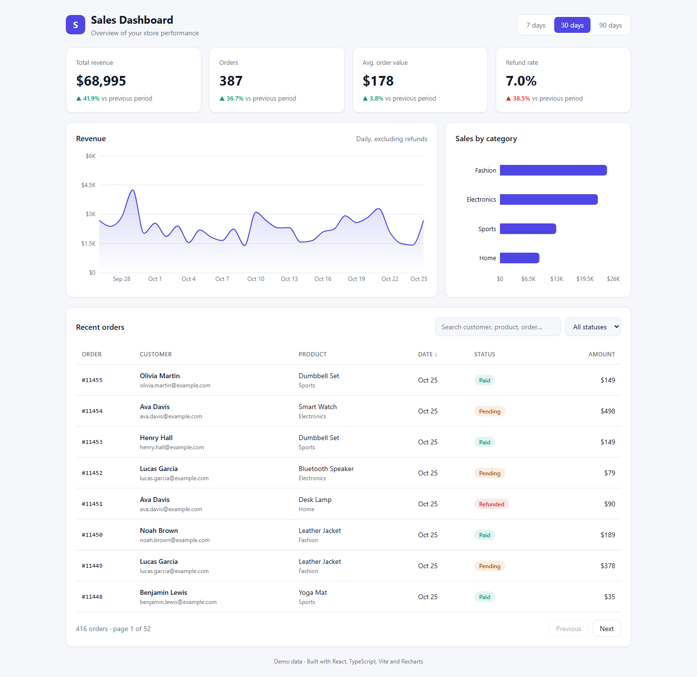

# Sales Dashboard

A responsive **React + TypeScript** analytics dashboard for an online store.
Built as a portfolio sample to show clean component structure, data visualization and table UX.



## Features

- **KPI cards** with period-over-period comparison (revenue, orders, average order value, refund rate)
- **7 / 30 / 90 day** range switcher, with all widgets updating together
- Interactive **revenue area chart** and **sales by category** bar chart (Recharts)
- **Orders table** with search, status filter, column sorting and pagination
- Responsive layout (desktop, tablet, mobile)
- Automatic **dark mode** that follows the system theme
- Fully typed with TypeScript, no UI framework needed

## Tech stack

React 19 · TypeScript · Vite · Recharts · plain CSS (custom properties)

## Project structure

```
src/
├── components/      # KpiCard, RevenueChart, CategoryChart, OrdersTable
├── data/            # Seeded mock data generator (swap for your API)
├── utils/           # Number / date formatting helpers
├── App.tsx          # Page layout and state
└── index.css        # Design tokens (light + dark)
```

## Getting started

Requires Node.js 20+.

```bash
npm install
npm run dev       # start dev server
npm run build     # production build in dist/
```

## Connecting a real backend

All data comes from `src/data/mockData.ts`. Replace `ordersInRange` / `dailySeries`
with calls to your REST API (for example the companion
[TaskFlow .NET API](../dotnet-taskflow-api) style backend) and the UI works unchanged.

---

Need a custom React dashboard or admin panel? Contact me on Fiverr.
